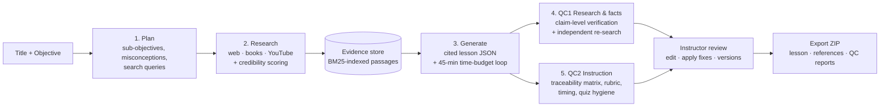

# LessonForge: AI lesson creation with two independent QC layers

**▶ Demo video:** [Watch on Google Drive](https://drive.google.com/file/d/1dToN6mjShkUByGHek_5U-NRvJUUIf8In/view?usp=drivesdk)

LessonForge turns a **lesson title + learning objective** into a researched, cited **45-minute lesson**.
It then audits the lesson with **two independent quality-control layers** and lets the instructor review,
edit, apply fixes, version and export the result.



**New here?** Read [`docs/USER_GUIDE.md`](docs/USER_GUIDE.md).  
**Requirements checklist:** every line of the brief is mapped to code and to an automated test in [`docs/REQUIREMENTS.md`](docs/REQUIREMENTS.md) (`pytest tests/test_requirements.py -v`).

## What makes it different

| Problem with naive "ask an LLM for a lesson" | What LessonForge does |
|---|---|
| Invented facts and fake links | The generator may only cite **retrieved evidence passages** (`[S1]`). URLs are never written by the model: references are built in code from real sources, and citations to non-existent sources are removed automatically. |
| "Fact-checking" by the same model that wrote it | QC runs on a **separate prompt and, optionally, a different model** (`QC_LLM_PROVIDER`). It never sees the generator's prompt. |
| Unsourced claims and wrong claims treated the same | QC1 extracts **atomic claims** and judges each one on **two signals**: is it backed by the evidence, and is it correct according to expert knowledge? "True but unsourced" (minor) is kept separate from "wrong" (critical). |
| Checking only against the sources it already chose | Claims that are unsupported or contradicted trigger a **second-opinion web search** the generator never saw. The claim is re-verified against that new source, which can then be cited with one click. |
| "Fits 45 minutes" taken on trust | A **deterministic timing model** covers both self-paced and instructor-led delivery (reading vs speaking speed, code, activities, quiz, in-lesson videos). An automatic resize pass runs if the draft misses the budget. |
| Vague "objective alignment" | A **traceability matrix** checks that every sub-objective is *taught*, *practised* and *assessed*. A key-term check catches gaps such as `5xx` never appearing in the lesson. |
| LLM reviewers that can be talked into passing | QC2 runs **deterministic checks first**: structure, Bloom-verb alignment, answer-position bias, longest-option cue, readability, section length. The rubric reviewer receives these findings as context. |
| Fixes that rewrite everything | Each fix is **targeted**: exact text replacement where possible, otherwise an edit to one section or to the quiz only. Every change becomes a **new version** with a diff, and you can restore any version. |
| Lost work | Every step is persisted and **retryable from the failed step**. Instructor edits are append-only versions. Version conflicts are detected (HTTP 409). Unsaved edits are backed up in the browser. |

## Quick start (Windows: 3 clicks)

**Requirements:** Python 3.10+ (tick "Add Python to PATH" when installing) and at least one free API key:
Gemini (https://aistudio.google.com/apikey) and/or Groq (https://console.groq.com/keys). Having both is best.

1. Download the code (green **Code** button → **Download ZIP**, or `git clone https://github.com/NanditaPatni/lessonforge.git`) and open the `lessonforge` folder (the one containing `app`, `static`, `setup.bat`).
2. Double-click **`setup.bat`**. It creates a virtual environment, installs packages, asks for your keys,
   **tests which models work right now**, writes `.env`, and opens http://localhost:8000.
3. Next time just double-click **`run.bat`**. If a model starts failing later (providers retire or overload
   free models), double-click **`doctor.bat`**: it re-tests and rewrites `.env`.

macOS / Linux: `./run.sh` (first run does the same setup).

Manual setup, if you prefer:
```bash
python -m venv .venv
.venv\Scripts\activate          # macOS/Linux: source .venv/bin/activate
pip install -r requirements.txt
python -m app.doctor             # asks for keys, picks working models, writes .env
python -m uvicorn app.main:app --port 8000
```

### Why the doctor exists
Free-tier models fail in three ways: a retired model name returns 404, an overloaded model returns 503, and a
small per-minute token limit returns 413 or cuts off the output. The doctor does not hard-code a model. It lists what
your keys can access, sends each candidate a tiny JSON request, and writes an ordered chain:
* the best working model (ranked by a fixed quality order, not by speed) becomes the **generator**
* a model from the **other provider** becomes the **QC reviewer** (independent review)
* the rest become `FALLBACK_LLM`. If a call fails, the same request is retried down the chain, and the first
  model that works is reused for the rest of that step.

Generation is also **chunked**: one call writes the outline and quiz, then the sections are written in batches of 3.
Every request stays small enough for free-tier limits.

### Free API keys

| Purpose | Provider | Where |
|---|---|---|
| Generator LLM (recommended) | Google Gemini | https://aistudio.google.com/apikey |
| Independent QC reviewer (recommended) | Groq (e.g. `openai/gpt-oss-120b`) | https://console.groq.com/keys |
| Better web search (optional) | Tavily | https://app.tavily.com |
| Accurate YouTube metadata (optional) | YouTube Data API v3 | Google Cloud Console → enable "YouTube Data API v3" → create API key |

Without Tavily or YouTube keys, research uses DuckDuckGo search, which needs no key. Books use Google Books and Open Library, which also need no key.

To run QC on a **different model** (stronger independence), add both keys and set one provider to write and the other to review, for example:
```
LLM_PROVIDER=groq
LLM_MODEL=openai/gpt-oss-120b
QC_LLM_PROVIDER=gemini
QC_LLM_MODEL=gemini-flash-lite-latest
```

Provider model names change over time. If you get a "model not found" error, set `LLM_MODEL` / `QC_LLM_MODEL` in `.env` to a current model.

## Using it

1. Click the **HTTP** sample (or type your own) and click **Generate lesson**. The 5 steps and the activity log update live.
2. When it finishes, follow the numbered path at the top. Each page has **← Back / Next →** buttons at the bottom:
   1. **Sources**: every source with its credibility tier, the reason for it, and the research plan.
   2. **Lesson**: **Preview** what learners see, or switch to **✎ Edit** (sections, quiz, videos, notes; **Ctrl+S** saves a new version).
   3. **Fact check (QC 1)**: claim table (evidence verdict + expert check), source reliability, dead links, and issues.
   4. **Teaching check (QC 2)**: rubric scores, traceability matrix, objective key terms, timing, and issues.
   5. **Export**: a ZIP with `lesson.md/.html/.json`, `references.md`, `qc1_research_report.md`, `qc2_instruction_report.md`, `qc_reports.json` and `version_history.json`.
3. On the two check pages, each issue has its own **✓ Apply** and **✕ Dismiss** button. Applying creates a new version; click **↻ Check again** to re-audit it.
4. **History** (top right of the path): view, diff or restore any version.

If a step fails (network, rate limit, bad key), the error appears on that step with a **Retry** button. Earlier steps are not repeated.

### Headless / CLI

```bash
python -m app.cli --title "HTTP Requests and Responses" \
  --objective "Explain GET and POST methods and distinguish between 2xx, 4xx, and 5xx response status categories." \
  --apply-critical
# writes samples/http-requests-and-responses.zip
```

### Offline mode (no keys, no internet)

```
LLM_PROVIDER=mock
RESEARCH_MODE=mock
```
This mode uses a deterministic mock model and fixture sources. It is useful for exploring the UI and for the test suite. For real results, use a real provider.

## When something goes wrong
* **A step turns red:** the app has already retried it once automatically. Click **Retry**. If the error mentions a
  model (404/503/413), run `doctor.bat` (or `python -m app.doctor`), restart with `run.bat`, then click **Retry**.
* **A yellow "Partial report" banner** means one QC sub-check could not run (usually a busy model). Everything else in
  the report is valid. Click **↻ Check again** later.
* **"Pipeline already running"** means an apply or re-run is still in progress. Wait for the activity log to finish.

## Tests

```bash
pytest -q          # 173 tests, no API keys or internet needed
```
- `tests/test_pipeline.py`: full pipeline through the API, empty-input validation, versioning and edit conflicts, applying QC fixes, retrying a failed step, removal of hallucinated citations, BM25, credibility tiers.
- `tests/test_chaos.py`: 120 runs with a fake model that randomly returns malformed-but-parseable JSON (bare lists,
  wrapper objects, renamed keys, options as dicts, scores as strings). Every step must still finish and every QC fix
  must apply without crashing.
- `tests/test_requirements.py`: one test per requirement in the brief (see `docs/REQUIREMENTS.md`).
- `tests/test_research_fallbacks.py`: research still finds web pages, books and videos when the planned searches are too narrow or fail.
- `tests/test_live_path.py`: runs the **live** code path (Gemini adapter, research collector, link checks, second-opinion re-search) with the network faked. It plants a factual error ("GET is not idempotent") and asserts that QC1 flags it as critical, that the independent search confirms it, and that the exact-text fix corrects it.

## Project structure

```
app/
  main.py               FastAPI routes (lessons, retry, save/conflict, QC apply/dismiss, versions/diff, preview, export)
  config.py             .env settings, provider defaults
  llm.py                provider-agnostic client: Gemini/Groq/OpenAI/Anthropic/OpenRouter/Ollama/mock,
                        retries with backoff, forced JSON + validation + re-ask
  prompts.py            every prompt in one reviewable file
  db.py                 SQLite: lessons, per-step outputs, append-only versions, event log
  export.py             Markdown/HTML/JSON renderers, QC report writers, ZIP bundle
  cli.py                headless runner
  mock_llm.py           offline deterministic model for tests/demo
  research/
    web.py              Tavily / DuckDuckGo search, trafilatura extraction, link checker
    books.py            Google Books → Open Library fallback
    youtube.py          YouTube Data API / DDG video search + transcripts
    credibility.py      transparent rule-based source tiers
    collector.py        query → fetch → score → select (domain diversity) → chunk into evidence
    text.py             tokeniser, chunker, BM25, readability
    mock_data.py        offline fixtures
  pipeline/
    orchestrator.py     resumable 5-step state machine (background thread)
    planner.py          objective decomposition + search plan
    generator.py        evidence-grounded generation + time-budget loop
    lesson_model.py     schema normalisation, citation sanitising, timing model
    evidence.py         credibility-weighted BM25 retrieval
    qc_research.py      QC layer 1
    qc_instruction.py   QC layer 2
    issues.py           shared issue format
    apply.py            targeted application of QC fixes
static/                 single-page UI (vanilla JS, no build step)
tests/                  pytest suite
docs/DESIGN.md          design decisions and trade-offs
docs/REQUIREMENTS.md    brief → implementation → test traceability
docs/DEMO_SCRIPT.md     shot-by-shot demo video script
docs/USER_GUIDE.md      how to use the app (workflow, colours, troubleshooting)
```

## Known limitations

- Full book text is not freely available. Books contribute publisher descriptions as weak evidence and appear as further reading.
- YouTube can rate-limit transcript downloads. When it does, video relevance falls back to the title and description, and this is shown in the UI.
- The timing model uses average reading and speaking speeds. It is a planning estimate, not a guarantee.
- The "expert knowledge" signal in QC1 is itself a model judgement. That is why it is reported separately from the evidence verdict and backed by independent re-search.

## Acknowledgements

Built with FastAPI, httpx, Pydantic, trafilatura, ddgs (DuckDuckGo search), youtube-transcript-api, Python-Markdown and SQLite.
Data from Google Gemini / Groq APIs, Google Books, Open Library, YouTube and the web pages cited in each lesson's references.
The BM25 formula follows Robertson & Zaragoza, "The Probabilistic Relevance Framework: BM25 and Beyond" (2009).
The Flesch Reading Ease formula is from Flesch (1948).
AI assistants were used during development for coding and debugging help. All design decisions are documented in `docs/DESIGN.md`.
